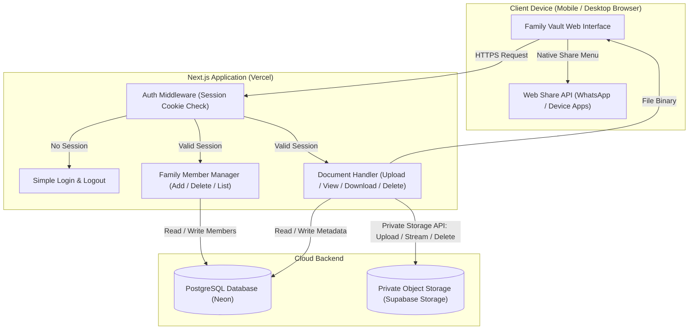

# System Architecture: Simple Family Document Vault

## 1. Architectural Overview

The architecture is deliberately minimal, direct, and focused on core functionality without unnecessary complexity.



---

## 2. Technology Stack

| Layer | Technology | Role & Justification |
| :--- | :--- | :--- |
| **Framework** | **Next.js (App Router) + TypeScript** | Unified full-stack app. Server Actions handle database and file operations securely without needing a separate backend server. |
| **Styling** | **Clean Modern CSS** | Clean, responsive, and functional layout. Prioritizes clear buttons, readable typography, and effortless mobile usability. |
| **Database** | **PostgreSQL (Neon Serverless)** | Lightweight relational storage for family member names and document metadata. Scales to zero, wakes up instantly, and **never pauses after inactivity** on its free tier. |
| **File Storage** | **Supabase Storage** | Private, secure object storage with server-side access control. Keeps buckets private with zero public access. |
| **Hosting** | **Vercel** | Free hosting tier for Next.js with automatic HTTPS and global edge distribution. |

---

## 3. Core System Workflows

### 3.1 Authentication Workflow
1. User navigates to the website.
2. Next.js middleware checks for a valid, signed session cookie.
3. If absent, the user is redirected to `/login`.
4. The user submits the shared family password.
5. On match, a secure `httpOnly` cookie is set, granting access to all family records.

### 3.2 Family Member & Document Workflow
1. **Home Screen**: Displays the list of family members with an "Add Family Member" input (name only).
2. **Selecting a Member**: Loads the document collection belonging to that person.
3. **Uploading a Document**:
   - The user selects a file (`.pdf`, `.jpg`, `.jpeg`, `.png`) and enters a name (e.g. "Passport").
   - Server Action verifies the file format and size (< 25 MB).
   - Generates a clean storage key: `documents/{member_id}/{uuid}.{ext}`.
   - Streams the binary to the private Supabase Storage bucket.
   - Saves a record to the `documents` table in PostgreSQL.
4. **Viewing / Downloading a Document**:
   - Server validates the active family session.
   - Fetches the file securely from Supabase Storage and streams it to the user with proper `Content-Type` and `Content-Disposition`.
5. **Deleting a Document**:
   - Server removes the file from private cloud storage and deletes the database record.

### 3.3 Sharing Workflow
1. User clicks **Share** on any document.
2. The browser fetches the document binary through the authenticated download endpoint.
3. **On Mobile (Smartphones/Tablets)**:
   - Uses the browser's native **Web Share API**:
     ```javascript
     if (navigator.canShare && navigator.canShare({ files: [file] })) {
       await navigator.share({
         files: [file],
         title: documentName,
       });
     }
     ```
   - This immediately opens the device's native share drawer with **WhatsApp**, Messages, AirDrop, Gmail, etc.
4. **On Desktop Browsers (or unsupported mobile browsers)**:
   - Automatically downloads the file to the user's downloads folder.
   - Shows a simple notification: *"File downloaded. You can now attach it in WhatsApp, email, or your preferred application."*

---

## 4. Free Tier & Practical Capacity

- **Database (Neon)**: 0.5 GB free storage. Enough for over 100,000 document metadata rows.
- **File Storage (Supabase Storage)**: 1 GB free storage on the free tier. Holds hundreds of document scans/PDFs.
- **Hosting (Vercel)**: 100 GB bandwidth / month free, far exceeding personal family requirements.
- **Estimated Ongoing Cost**: **$0.00 / month**.
