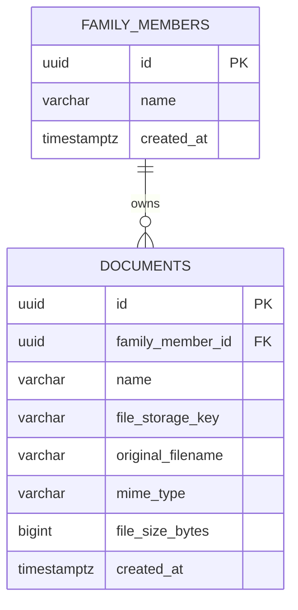

# Database Design: Simple Family Document Vault

## 1. Schema Overview

The database design is stripped down to the absolute essentials needed to fulfill the requirements:
- Only **two tables**: `family_members` and `documents`.
- No categories, tags, share tokens, audit logs, or complex metadata tables.
- Foreign key cascade: deleting a family member cleanly deletes their associated documents.

---

## 2. Entity Relationship Diagram (ERD)



---

## 3. Data Dictionary

### 3.1 `family_members`
Stores the list of family members. Contains only their name.

| Column | Type | Constraints | Description |
| :--- | :--- | :--- | :--- |
| `id` | UUID | PK, `DEFAULT gen_random_uuid()` | Unique member ID |
| `name` | VARCHAR(150) | NOT NULL | Member name (e.g., "Father", "Sarah", "John") |
| `created_at` | TIMESTAMPTZ | NOT NULL, `DEFAULT NOW()` | Date member was added |

### 3.2 `documents`
Stores document records linked to a family member.

| Column | Type | Constraints | Description |
| :--- | :--- | :--- | :--- |
| `id` | UUID | PK, `DEFAULT gen_random_uuid()` | Unique document ID |
| `family_member_id` | UUID | FK -> `family_members(id)`, ON DELETE CASCADE | Associated family member |
| `name` | VARCHAR(255) | NOT NULL | User-provided name (e.g., "Passport", "Driving Licence") |
| `file_storage_key` | VARCHAR(500) | NOT NULL | Opaque file path in private Supabase Storage bucket |
| `original_filename` | VARCHAR(255) | NOT NULL | Original upload name (e.g. `scan_01.pdf`) |
| `mime_type` | VARCHAR(100) | NOT NULL | Content type (`application/pdf`, `image/jpeg`, `image/png`) |
| `file_size_bytes` | BIGINT | NOT NULL | File size in bytes |
| `created_at` | TIMESTAMPTZ | NOT NULL, `DEFAULT NOW()` | Upload timestamp |

---

## 4. SQL Schema & Indexes

```sql
-- Family Members Table
CREATE TABLE family_members (
    id UUID PRIMARY KEY DEFAULT gen_random_uuid(),
    name VARCHAR(150) NOT NULL,
    created_at TIMESTAMPTZ NOT NULL DEFAULT NOW()
);

-- Documents Table
CREATE TABLE documents (
    id UUID PRIMARY KEY DEFAULT gen_random_uuid(),
    family_member_id UUID NOT NULL REFERENCES family_members(id) ON DELETE CASCADE,
    name VARCHAR(255) NOT NULL,
    file_storage_key VARCHAR(500) NOT NULL,
    original_filename VARCHAR(255) NOT NULL,
    mime_type VARCHAR(100) NOT NULL,
    file_size_bytes BIGINT NOT NULL,
    created_at TIMESTAMPTZ NOT NULL DEFAULT NOW()
);

-- Fast lookup of documents by family member
CREATE INDEX idx_documents_family_member ON documents (family_member_id);
```

---

## 5. Authentication Storage Note

To keep the database purely focused on family documents:
- The shared family password is held securely as a hashed secret (`FAMILY_PASSWORD_HASH`) in the server's environment variables.
- This eliminates the need for an extra user management table, registration endpoints, or account sync issues.
